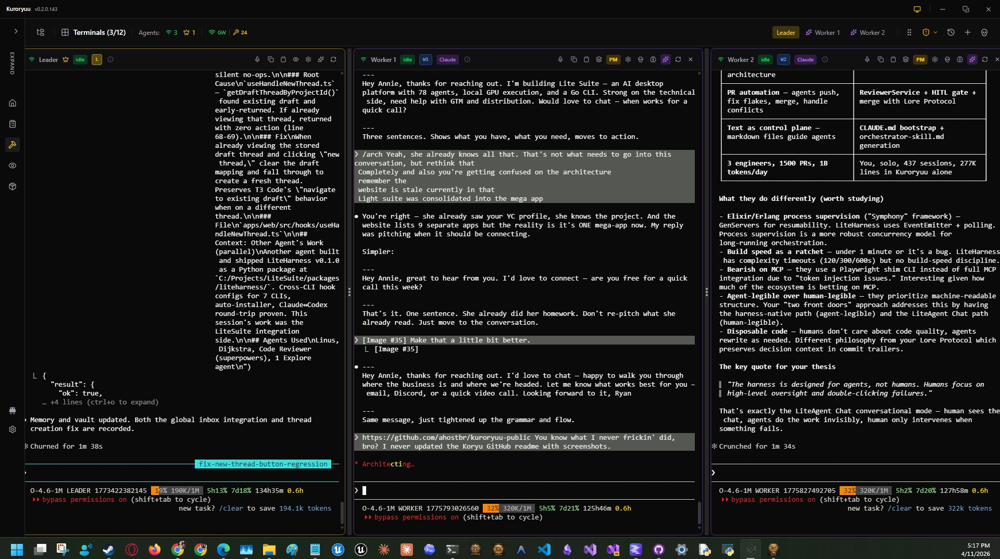
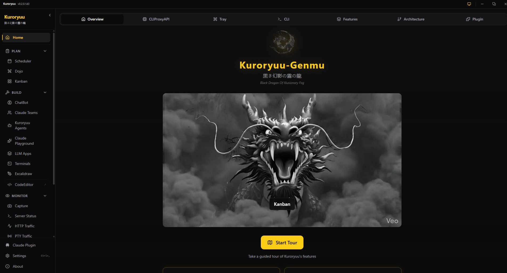
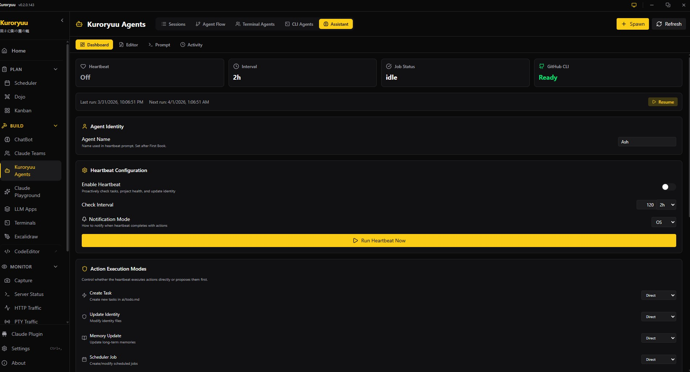
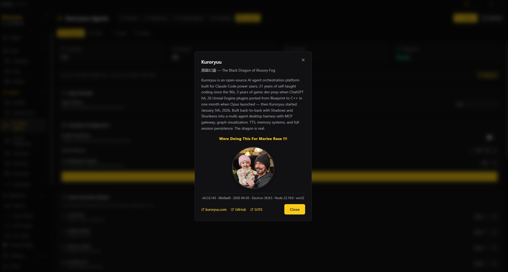

# Kuroryuu - Plataforma de Orquestación IA Multi-Agente
Visita:
https://www.kuroryuu.com/
Para más información:

> **Participación en el Hackathon Dynamous x Kiro** | 5-30 de enero de 2026 | 26 días de desarrollo

Kuroryuu (黒き幻影の霧の龍 - "Dragón Negro de la Niebla Ilusoria") es una plataforma de orquestación IA multi-agente lista para producción que permite a agentes de IA autónomos colaborar en tareas complejas de desarrollo de software. Incluye orquestación con el agente líder Ralph, automatización de escritorio mediante PowerShell/APIs de Win32 y más de 61 modelos LLM distribuidos en 6 proveedores.









## Prerrequisitos

**Para Windows (instalación nativa):**
- **Python 3.12** (requerido para MCP Core - utiliza características de FastAPI no disponibles en versiones anteriores)
- **Node.js 18+** (para las aplicaciones de escritorio y web)
- **Git** (para clonar)
- **Windows** (scripts de PowerShell, APIs de Win32 para automatización de escritorio)

**Para Docker (multiplataforma):**
- **Docker** con Docker Compose
- Funciona en Windows, Linux y macOS

## Instalación

### 1. Clonar el repositorio

```powershell
git clone https://github.com/ahostbr/kuroryuu-public
cd kuroryuu-public
```

### 2. Ejecutar el script de configuración

```powershell
.\setup-project.ps1
```

Este script automáticamente:
- Establece la variable de entorno `KURORYUU_PROJECT_ROOT` (persistente)
- Genera `.mcp.json` desde la plantilla con rutas resueltas
- Crea un entorno virtual de Python 3.12 (`.venv_mcp312`)
- Instala todas las dependencias de Python (mcp_core, gateway, mcp_stdio)
- Instala todas las dependencias de Node.js (desktop, pty_daemon, web)
- Verifica los activos de compilación requeridos

**Banderas opcionales:**
```powershell
.\setup-project.ps1 -SkipPython   # Omitir entorno virtual y dependencias de Python
.\setup-project.ps1 -SkipNode     # Omitir dependencias de Node.js
.\setup-project.ps1 -Force        # Sobrescribir configuraciones existentes
```

### 3. Reiniciar la terminal

Una vez finalizada la configuración, **reinicia tu terminal** para aplicar la nueva variable de entorno.

### 4. Iniciar todos los servicios

```powershell
.\run_all.ps1
```

## Inicio rápido (después de la instalación)

```powershell
# Iniciar todos los servicios (gateway, mcp_core, desktop)
.\run_all.ps1

# Detener todos los servicios
.\kill_all.ps1

# O iniciar individualmente
cd apps/gateway && python server.py        # Gateway (puerto 8200)
cd apps/mcp_core && python server.py       # MCP Core (puerto 8100)
cd apps/desktop && npm run dev             # Aplicación de escritorio
```

Accede a la aplicación:
- **Aplicación de escritorio**: Se inicia automáticamente
- **API Gateway**: http://127.0.0.1:8200/docs
- **MCP Core**: http://127.0.0.1:8100/mcp

## Instalación con Docker (desarrollo de backend / CI)

El soporte de Docker está destinado a **desarrolladores de backend** y **pipelines de CI**. Kuroryuu tiene prioridad en Windows; la funcionalidad completa requiere una instalación nativa en Windows.

### Inicio rápido

```bash
# 1. Clonar repositorio
git clone https://github.com/ahostbr/kuroryuu-public
cd kuroryuu-public

# 2. Configurar entorno
cp .env.example .env
# Editar .env y configurar ANTHROPIC_API_KEY (requerido para chat)

# 3. Iniciar todos los servicios
docker-compose up -d

# 4. Verificar estado
docker-compose ps
curl http://localhost:8100/health   # MCP Core
curl http://localhost:8200/v1/health # Gateway
curl http://localhost:7073/health   # PTY Daemon
curl http://localhost:3000/         # Interfaz Web
```

### Servicios

| Servicio | Puerto | Endpoint de estado | Propósito |
|---------|------|-----------------|---------|
| MCP Core | 8100 | `/health` | Servidor de herramientas MCP (15 herramientas, 107 acciones) |
| Gateway | 8200 | `/v1/health` | FastAPI + WebSocket, transmisión de chat |
| PTY Daemon | 7072 (RPC), 7073 (estado) | `/health` | Backend de emulación de terminal |
| Interfaz Web | 3000 | `/` | SPA en React servida a través de nginx |

### Variables de entorno

Copia `.env.example` a `.env` y configúralo:

```env
# Requerido para funcionalidad de chat
ANTHROPIC_API_KEY=sk-ant-your-key-here

# Anulaciones opcionales
KURORYUU_GATEWAY_PORT=8200
KURORYUU_MCP_PORT=8100
KURORYUU_AUTH_ENABLED=true
KURORYUU_AUTH_PASSWORD_HASH=<sha256-hash>
```

### Comandos de Docker

```bash
# Iniciar en segundo plano
docker-compose up -d

# Ver registros (modo seguimiento)
docker-compose logs -f

# Ver registros de un servicio específico
docker-compose logs -f gateway

# Reconstruir después de cambios en el código
docker-compose build
docker-compose up -d

# Detener todos los servicios
docker-compose down

# Detener y eliminar volúmenes (limpiar todo)
docker-compose down -v
```

### Limitaciones en modo Docker

Las funciones exclusivas de Windows se desactivan automáticamente:
- `k_capture` - Requiere APIs de visualización de Win32
- `k_pccontrol` - Requiere PowerShell + APIs de Win32
- Aplicación Electron de escritorio - Usa la interfaz web en su lugar
- Companero de bandeja - Requiere SAPI de Windows

**Para la funcionalidad completa**, incluida la automatización de escritorio, usa la instalación nativa de Windows.

## Vista general de la arquitectura

```
┌─────────────────────────────────────────────────────────────┐
│                    Kuroryuu Desktop                          │
│  ┌─────────┐ ┌─────────┐ ┌─────────┐ ┌─────────────────┐   │
│  │ Leader  │ │ Worker  │ │ Worker  │ │   Command       │   │
│  │Terminal │ │Terminal │ │Terminal │ │   Center        │   │
│  └────┬────┘ └────┬────┘ └────┬────┘ └────────┬────────┘   │
└───────┼──────────┼──────────┼─────────────────┼─────────────┘
        │          │          │                 │
        └──────────┴──────────┴─────────────────┘
                         │
              ┌──────────▼──────────┐
              │    Gateway (8200)    │
              │  FastAPI + WebSocket │
              └──────────┬──────────┘
                         │
              ┌──────────▼──────────┐
              │   MCP Core (8100)    │
              │  15 Tools→107 Actions│
              └─────────────────────┘
```

### Componentes clave

- **Gateway**: Servidor FastAPI con 21 enrutadores, registro de agentes, eventos WebSocket y chat por transmisión
- **MCP Core**: 15 herramientas MCP con 107 acciones enrutadas (RAG, Buzón, Puntos de control, PTY, PCControl...)
- **Escritorio**: Electron + React + TypeScript con 235 componentes, 16 pantallas y 13 modales
- **Kuroryuu CLI**: REPL de Python con 6.137 LOC y 24 comandos con barra, 61+ modelos a través de 3 proveedores
- **Patrón Líder/Trabajador**: Orquestación de Ralph con monitoreo y estímulos desde el escritorio

## Integración con Kiro CLI

Este proyecto se desarrolló utilizando [Kiro CLI](https://kiro.dev) para desarrollo impulsado por IA.

### Estadísticas de desarrollo

| Métrica | Valor |
|--------|-------|
| Días de desarrollo | 26 |
| Sesiones totales | 460+ |
| Tareas completadas | 445 |
| Herramientas MCP | 15 (107 acciones) |
| Componentes React | 235 |
| Pantallas de escritorio | 16 + 13 modales |
| Enrutadores de Gateway | 21 |
| **Total de LOC del código fuente** | **235,626** |
| Escritorio (TypeScript) | 95,426 |
| Gateway (Python) | 23,097 |
| MCP Core (Python) | 10,292 |
| Kuroryuu CLI (Python) | 6,137 |
| Comandos CLI | 24 |
| Modelos LLM admitidos | 61+ |
| Comandos de complementos | 20 |
| Registros de trabajo | 602 |
| Puntos de control | 706 |

### Prompts personalizados (`ai\prompts\workflows\`)

| Prompt | Propósito |
|--------|---------|
| `@prime` | Cargar contexto integral del proyecto |
| `@plan-feature` | Diseñar arquitectura de la funcionalidad |
| `@execute` | Implementación sistemática con seguimiento de tareas |
| `@code-review` | Garantía de calidad antes de los commits |
| `@code-review-hackathon` | Evaluación según rúbrica del hackathon |
| `@rca` | Análisis de causa raíz para depuración |
| `@create-prd` | Documentación de requisitos |
| `@system-review` | Verificación de integración |

### Documentos de dirección (`.kiro/steering/`)

- **product.md** - Visión del producto y perfiles de usuario
- **tech.md** - Arquitectura técnica y estándares
- **structure.md** - Patrones de organización del proyecto
- **CONVENTIONS.md** - Pautas de estilo de código
- **RULES.md** - Principios de desarrollo
- **kuroryuu-mcp.md** - Convenciones específicas de MCP

### Flujo de trabajo de desarrollo

1. `@prime` - Cargar contexto al iniciar la sesión
2. `@plan-feature` - Diseñar antes de codificar
3. `@execute` - Implementar con seguimiento de tareas
4. `@code-review` - Garantizar calidad antes del commit
5. Actualizar documentos de dirección - Mantener la base de conocimientos

### Herramientas MCP (16 Herramientas → 115 Acciones Enrutadas)

Kiro CLI se conecta directamente al servidor MCP de Kuroryuu, proporcionando acceso a:

| Herramienta | Acciones | Propósito |
|------|---------|---------|
| **k_rag** | 12 | Búsqueda multiestrategia (palabra clave, semántica, híbrida, reflexiva, agente) |
| **k_pty** | 12 | Control e inyección de terminal |
| **k_inbox** | 8 | Mensajería Maildir |
| **k_msg** | 8 | Mensajería interagente simplificada (enviar, verificar, leer, responder, transmitir) |
| **k_capture** | 8 | Captura de pantalla |
| **k_pccontrol** | 8 | Automatización de escritorio vía PowerShell/APIs Win32 (ACTIVACIÓN VOLUNTARIA) |
| **k_session** | 7 | Ciclo de vida de la sesión |
| **k_memory** | 7 | Memoria de trabajo |
| **k_graphiti_migrate** | 6 | Migración de grafos de conocimiento |
| **k_collective** | 6 | Coordinación de agentes |
| **k_repo_intel** | 5 | Inteligencia de repositorio |
| **k_files** | 5 | Operaciones de archivos |
| **k_checkpoint** | 4 | Persistencia de sesión |
| **k_thinker_channel** | 3 | Comunicación del agente pensador |
| **k_MCPTOOLSEARCH** | 2 | Descubrimiento de herramientas |
| **k_help** | - | Sistema de ayuda |

## Características

### Orquestación Multi-Agente (Líder Ralph)

**Ralph** es el agente líder autónomo que orquesta a los trabajadores:
- El escritorio monitorea la inactividad de Ralph y envía estímulos
- Ralph monitorea a los trabajadores mediante k_pty en busca de señales de promesa
- Habilidades: `/k-ralph`, `/ralph_done`, `/ralph_progress`, `/ralph_stuck`
- Monitoreo visual mediante LeaderMonitorModal en el escritorio

**Características principales:**
- Patrón líder/trabajador con delegación jerárquica de tareas
- Modelo de seguridad de cierre ante fallos (la caída del líder bloquea la interfaz)
- Registro de agentes en tiempo real con monitoreo de latido
- k_pccontrol para automatización completa del escritorio de Windows (ACTIVACIÓN VOLUNTARIA)

### Aplicación de Escritorio (235 Componentes React)
- 16 pantallas principales + 13 modales con temas Kuroryuu/Matrix
- Cuadrícula de terminal con persistencia PTY (sobrevive a los reinicios)
- Centro de Comandos con pestañas de Agentes, Herramientas y Servidores
- Monitor de Tareas Claude con gráfico de dona + línea de tiempo Gantt
- Visualización del flujo de tráfico HTTP/PTY con gráficos de red
- Editor de código completo estilo VSCode con menciones @
- Administrador de Worktrees estilo GitHub Desktop
- Generador de changelog a partir de tareas completadas
- 437 transcripciones de conversaciones consultables

### Suite de Herramientas MCP (15 Herramientas, 107 Acciones)
- Arquitectura de herramientas enrutadas para evitar la proliferación excesiva de herramientas
- k_pccontrol para automatización completa del escritorio de Windows
- Búsqueda RAG con 12 estrategias (palabra clave, semántica, híbrida, agente...)
- Buzón basado en Maildir para mensajería multi-agente
- Integración de grafos de conocimiento Graphiti

### Kuroryuu CLI (6.137 LOC)

Un REPL de Python completo para desarrollo impulsado por IA:

```bash
cd apps/kuroryuu_cli
python -m kuroryuu_cli --help
```

**24 Comandos con barra (/):**
```
/help /exit /status /clear /context /compact /history
/config /model /provider /mode /permissions /doctor
/init /memory /tools /review /plan /execute /agents /ask /approve
```

**3 Proveedores, 61+ Modelos:**
- LMStudio (inferencia local)
- Claude API (con OAuth para Pro/Max)
- CLIProxyAPI (Anthropic, OpenAI, Gemini, GitHub Copilot, Kiro, Antigravity)

**Características:**
- Soporte para roles de Líder/Trabajador con aplicación de permisos
- Generación de subagentes (tipos Explorador, Planificador)
- Puertas de control humano en el ciclo (/ask, /approve)
- 3 modos de operación: Normal, Plan (ejecución de prueba), Solo lectura
- Transmisión AsyncIO con interfaz de terminal enriquecida

### Integraciones de CLI Bootstrap
- Archivos bootstrap para 8 herramientas de IA principales:
  - Kiro CLI, Cursor, Copilot, Cline, Windsurf, Codex, Antigravity

## Estructura de directorios

```
kuroryuu/
├── apps/
│   ├── gateway/          # Gateway FastAPI (puerto 8200)
│   ├── mcp_core/         # Servidor de herramientas MCP (puerto 8100)
│   ├── desktop/          # Aplicación Electron + React
│   └── web/              # Interfaz web Next.js
├── ai/
│   ├── checkpoints/      # Puntos de control de agentes
│   ├── prompts/          # Prompts de flujo de trabajo PRD-First
│   ├── collective/       # Biblioteca de patrones
│   └── traffic/          # Historial de solicitudes
├── .kiro/
│   ├── steering/         # Conocimiento del proyecto
│   ├── prompts/          # Prompts personalizados de Kiro
│   └── specs/            # Especificaciones de funcionalidades
├── Docs/
│   ├── DEVLOG.md         # Línea de tiempo de desarrollo
│   ├── worklogs/         # 602 registros de sesión
│   └── Plans/            # Planes de implementación
├── KURORYUU_BOOTSTRAP.md # Guía de bootstrap de agentes
├── KURORYUU_LEADER.md    # Instrucciones para el agente líder
└── KURORYUU_WORKER.md    # Instrucciones para el agente trabajador
```

## Solución de problemas

### El script de configuración falla: Python 3.12 no encontrado
```powershell
# Instalar Python 3.12 desde python.org
# Asegurarse de que el lanzador 'py' esté instalado (marcado por defecto)
py -3.12 --version   # Debería mostrar Python 3.12.x
```

### La aplicación de escritorio no se compila: icono faltante
La aplicación de escritorio requiere `apps/desktop/build/icon.png` (PNG 256x256).
Crea este archivo antes de ejecutar `npm run build` en la aplicación de escritorio.

### El Gateway no se inicia
```powershell
# Verificar si el puerto 8200 está en uso
netstat -an | findstr 8200

# Terminar proceso existente y reiniciar
.\kill_all.ps1
.\run_all.ps1
```

### Las herramientas MCP no responden
```bash
# Verificar estado de MCP Core
curl http://127.0.0.1:8100/health

# Verificar lista de herramientas
curl -X POST http://127.0.0.1:8100/mcp -d '{"jsonrpc":"2.0","method":"tools/list","id":1}'
```

### Terminales en blanco en la aplicación de escritorio
- Reinicia la aplicación (las terminales persisten mediante el daemon PTY)
- Verifica `ai/logs/main.log` en busca de errores

### Advertencia de caída del líder
- Esta es una seguridad de cierre ante fallos intencional
- Haz clic en "Reiniciar aplicación" para recuperar
- La primera terminal es siempre el líder

## Documentación

| Documento | Propósito |
|----------|---------|
| [DEVLOG.md](Docs/DEVLOG.md) | Línea de tiempo completa de desarrollo con estadísticas de Kiro CLI |
| [DEMO.md](DEMO.md) | Análisis técnico detallado con ejemplos de curl |
| [KURORYUU_BOOTSTRAP.md](KURORYUU_BOOTSTRAP.md) | Guía de bootstrap de agentes |
| [KURORYUU_LAWS.md](KURORYUU_LAWS.md) | Reglas operativas |

## Entrega del Hackathon

- **Duración**: 26 días de desarrollo (460+ sesiones)
- **Tareas completadas**: 445 en total
- **Código fuente total**: 235.626 LOC (TypeScript + Python)
- **Herramientas MCP**: 15 herramientas con 107 acciones enrutadas
- **Aplicación de escritorio**: 95.426 LOC en TypeScript (235 componentes React)
- **Gateway**: 23.097 LOC en Python (21 enrutadores)
- **Kuroryuu CLI**: 6.137 LOC en Python (24 comandos)
- **Modelos LLM**: 61+ a través de 6 proveedores
- **Documentación**: 602 registros de trabajo, 706 puntos de control

## Licencia

**AGPL-3.0** - Consulta [LICENSE](LICENSE) para obtener detalles.

Puedes usar, modificar y distribuir Kuroryuu libremente. Si lo modificas y lo implementas (incluido como servicio en red), debes hacer públicas tus modificaciones bajo la licencia AGPL-3.0.

---

**Desarrollado con Kiro CLI para el Hackathon Dynamous x Kiro 2026**
